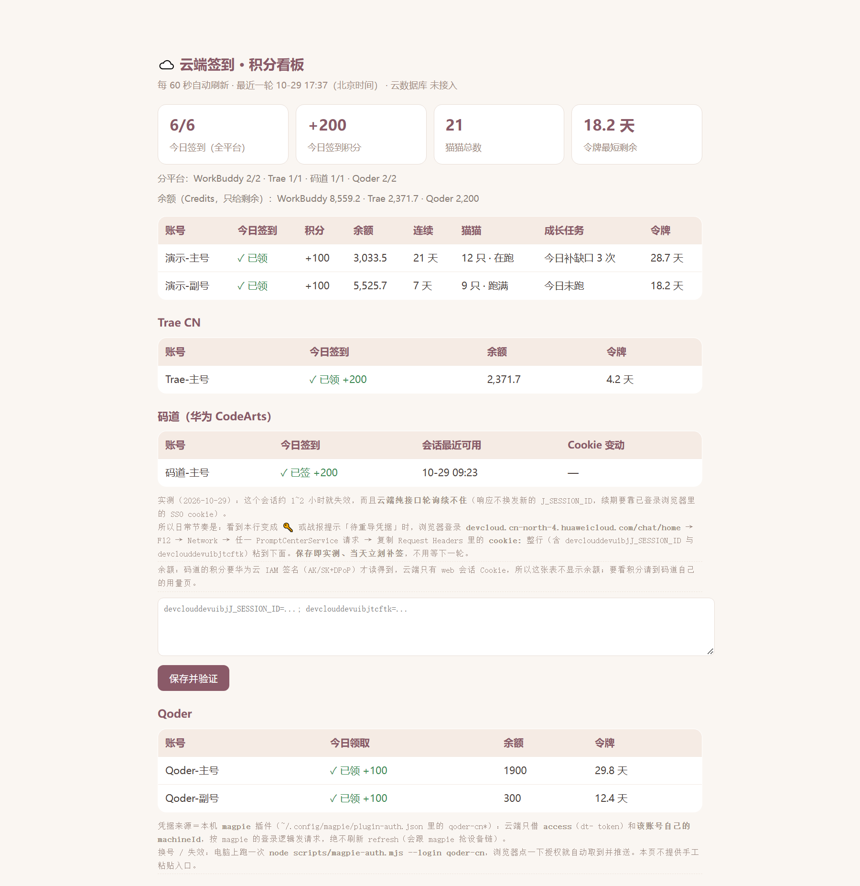
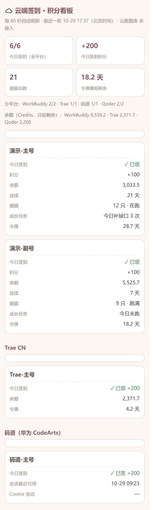
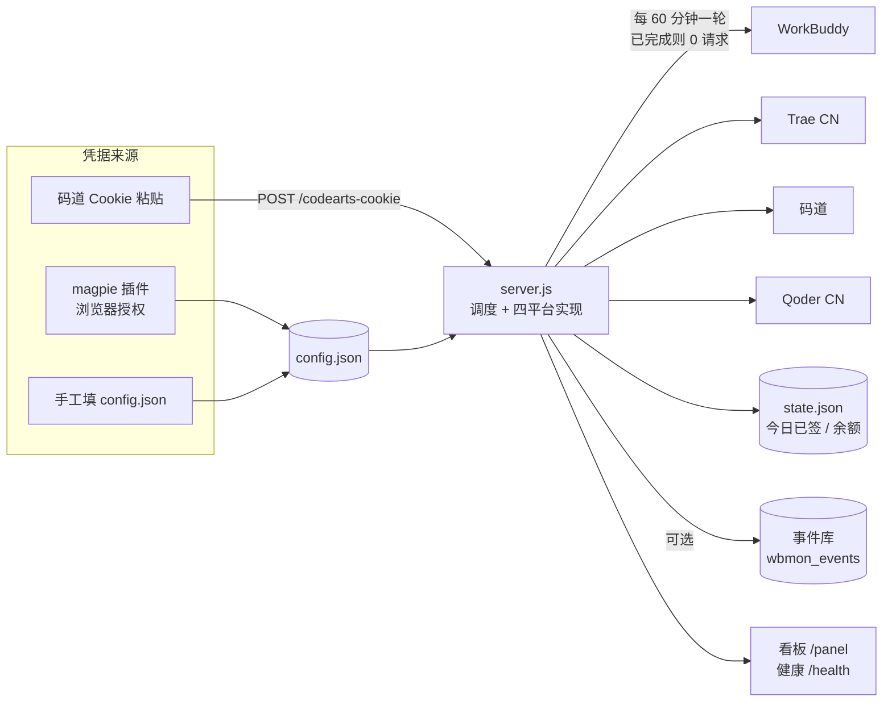

# cloud-signin-kit

[](LICENSE)
[](https://nodejs.org)
[](package.json)
[](https://github.com/jlp111/cloud-signin-kit/actions/workflows/ci.yml)

**签到跑在云上，不在你的电脑上。** 关掉电脑、不用带手机、出差两周，到点它照样把四个平台的签到做完。

> **English TL;DR** — A zero-dependency Node.js worker that keeps running **in the cloud**, claiming daily
> credits from WorkBuddy / Trae CN / Huawei Cloud CodeArts / Qoder CN — **even when your laptop is off**.
> Ships a mobile-friendly dashboard, health endpoint and CI self-tests. Setup takes three commands — see below.

## 核心区别：不依赖你开电脑

绝大多数签到脚本的隐含前提是"你的机器得醒着"——cron 要开机、油猴要浏览器开着、快捷指令要手机在线。本项目把这一步搬走了：它是一个**常驻云端**的进程，自己按小时调度，本机只在你需要"换票"时才出场。

| 方案 | 需要本机开机 | 谁在驱动 | 关机 / 断网 / 出差后 |
|---|---|---|---|
| 本机脚本 + cron / 计划任务 | ✅ 必须 | 你的电脑 | ❌ 停 |
| 浏览器插件（油猴等） | ✅ 浏览器得开着 | 你的浏览器 | ❌ 停 |
| 手机 App / 快捷指令 | ✅ 手机得在线 | 你的手机 | ❌ 停 |
| **本项目** | ❌ **不需要** | **云上常驻进程（默认 60 分钟一轮）** | ✅ **继续签** |

三段式，把"人"从流程里摘出去：

1. **一次性把凭据交给云端**（`--login` 导入或手填），之后本机就不再参与签到；
2. **云端自己调度**：每 60 分钟看一眼，今天签完的轮次 **0 请求**；`/health`、`/panel` 用任何设备打开都能远程看结果；
3. **本机只在换票时出场**（可选）：令牌快到期或换账号时跑一次 `--push`，其余时间电脑可以一直关着。

边界也写清楚，不吹：

- **WorkBuddy / Qoder / Trae**：凭据有效期分别约 29 / 30 / 4 天，期内**全程无人值守**；到期前续一次即可继续。
- **码道**：会话 Cookie 只能活 1~2 小时且平台不换发新票，**需要每天人工贴一次**——这是平台机制，任何方案都绕不过去（本项目把它压缩成"贴一次，其余自动"）。
- 云端机器本身得常开——但那是**云主机**，不是你的电脑。

## 覆盖哪些平台

| 平台 | 每日动作 | 凭据形态 | 能否自愈 |
|---|---|---|---|
| **WorkBuddy**（workbuddy.cn / codebuddy） | 每日签到 + 猫猫旅行（派出 / 收礼物） | OAuth access + refresh（约 30 / 60 天） | ✅ 有 refresh |
| **Trae CN**（api.trae.cn） | 签到领 credits（基础 100 + 额外 100） | `Cloud-IDE-JWT` + 设备 id（约 5 天） | ⚠️ 依赖上游刷新 |
| **码道 CodeArts**（华为云 devcloud） | 到访会话触发签到 | 浏览器会话 Cookie（1~2 小时） | ❌ 需人工粘贴 |
| **Qoder CN**（openapi.qoder.com.cn） | 领取 Add-on credits（+100/天） | `dt-` 设备 token + 每号独立 `machineId` | ⚠️ 依赖上游刷新 |

核心思路：**签到逻辑与凭据管理分离**。签到只读 `config.json`；凭据怎么来（人工、脚本、上游工具同步）都能换掉，不动业务代码。

> ⚠️ 本项目自动调用各平台自己的接口，可能违反其服务条款；**风险与合规由使用者承担**。请只用于自己拥有或被授权的账号。使用前请读 [SECURITY.md](SECURITY.md) 与[使用注意事项](#使用注意事项)。

## 目录

- [核心区别](#核心区别不依赖你开电脑)
- [覆盖哪些平台](#覆盖哪些平台)
- [长什么样](#长什么样)
- [架构](#架构)
- [特性](#特性)
- [项目结构](#项目结构)
- [快速开始](#快速开始)
- [配置方式](#配置方式)
- [凭据从哪来](#凭据从哪来)
- [部署](#部署)
- [升级与停止](#升级与停止)
- [常见问题](#常见问题)
- [HTTP 接口](#http-接口)
- [如何新增一个平台](#如何新增一个平台)
- [开发与自检](#开发与自检)
- [使用注意事项](#使用注意事项)
- [文档索引](#文档索引)
- [致谢 / 参考](#致谢--参考)
- [License](#license)

## 长什么样

<table>
  <tr>
    <td width="69%" valign="top">
      
    </td>
    <td width="31%" valign="top">
      
    </td>
  </tr>
  <tr>
    <td align="center"><sub>桌面：一屏看完签到、余额、猫猫、令牌剩余</sub></td>
    <td align="center"><sub>手机（≤640px）：每个账号一张卡片</sub></td>
  </tr>
</table>

> 截图为**演示数据**（虚构账号 `演示-主号` / `Trae-主号` 等，余额也是假的），不含任何真实账号与凭据。
> 想自己生成同款：`NO_START_TICK=1` 启动后用预置 `state.json` 渲染即可（见 [docs/CONFIG.md](docs/CONFIG.md#环境变量总览)）。

## 架构



三条不变式：

1. **幂等**：任何"领取"动作先查状态，已领则跳过；`state.json` 记 `day`，重启不会重复请求。
2. **失败隔离**：单账号失败只标 `🔑`，不拖垮整轮。
3. **单刷新链**：同一条 refresh 只能有一个主人，云端默认只借用 access（`refreshOwner`）。

## 特性

- **零运行时依赖**：只用 Node ≥18 内置模块（`http` / `fs` / `fetch`），连 `npm install` 都不用。
- **多账号**：每个平台是数组，加一条配置就多一个号，自动进入统计与看板。
- **平台注册表**：`PLATFORMS` 声明式描述"有哪些账号、今天签没签"，看板 / 健康检查 / 战报共用同一份事实来源——**加平台不用改渲染代码**。
- **按需节流**：空闲轮次 **0 请求**；只有真需要时才打接口（见[使用注意事项](#使用注意事项)）。
- **降级优先**：云数据库不可用只丢历史，不影响签到。
- **看板自适应**：桌面是表格，≤640px 自动变成"每个账号一张卡片"，不横向滚动。
- **可自检**：`node scripts/selftest.cjs` 用零账号配置起实例，验通所有端点。

## 项目结构

```
cloud-signin-kit/
├── src/
│   └── server.js              # 主服务：调度 + 四平台实现 + 看板 + HTTP 接口（单文件，零运行时依赖）
├── public/
│   └── index.html             # 落地页（读 /health 显示概览）；带 ?key= 显示「打开完整看板」
├── scripts/
│   ├── magpie-auth.mjs        # 复用上游插件的登录实现：浏览器授权 → 落配置 → 推云端
│   ├── sync-from-magpie.cjs   # 只读同步：把上游现成凭据批量同步到 config.json 并推送
│   ├── selftest.cjs           # 自检：起实例 + 打端点（CI 也用这个）
│   └── check-links.cjs        # 文档体检：相对链接 / 锚点
├── docs/
│   ├── CONFIG.md              # 配置项逐条说明
│   ├── PLATFORMS.md           # 四平台接口路径、凭据字段、错误码
│   ├── DEPLOY.md              # 部署与运维（环境变量、反代、systemd、Docker、计划任务）
│   └── images/                # 看板截图（演示数据渲染，供 README 引用）
├── db/schema.sql              # 可选：云端事件表
├── .github/                   # CI + issue / PR 模板
├── config.example.json        # 配置模板（占位符）
├── .env.example               # 环境变量模板
├── SECURITY.md  CONTRIBUTING.md  CHANGELOG.md  CODE_OF_CONDUCT.md
├── ACKNOWLEDGEMENTS.md        # 致谢 / 参考（开源项目、用途、链接、核验记录）
└── LICENSE                    # MIT
```

运行期生成（已在 `.gitignore`）：`config.json`、`state.json`、`run.log`。

## 快速开始

```bash
git clone https://github.com/jlp111/cloud-signin-kit.git
cd cloud-signin-kit

cp config.example.json config.json     # 填 access_key；账号可以先留空
node src/server.js                     # 或 npm start，默认 8080

curl http://127.0.0.1:8080/health
# 然后在浏览器打开：http://127.0.0.1:8080/panel?key=<你的 ACCESS_KEY>
```

第一次启动会立刻跑一轮，之后按 `TICK_MINUTES` 循环。想先空跑验证部署：把各平台 `accounts` 留成空数组即可。

## 配置方式

两套来源，**环境变量优先**：

1. `config.json`：结构见 [`config.example.json`](config.example.json)，字段逐条解释见 [`docs/CONFIG.md`](docs/CONFIG.md)。
2. 环境变量：见 [`.env.example`](.env.example)，适合云上部署，避免把凭据提交进仓库。

| 环境变量 | 覆盖 | 说明 |
|---|---|---|
| `ACCESS_KEY` | `config.access_key` | 后台密钥，`/panel`、`/status`、`/tick` 等都要带 |
| `CLOUD_DB_ENDPOINT` / `CLOUD_DB_KEY` / `CLOUD_DB_RESOURCE` | `config.cloud.*` | 可选事件库 |
| `CLOUD_BASE` | 脚本推送目标 | 默认 `http://127.0.0.1:$PORT` |
| `SHARE_CODE` | 脚本推送的 `sharecode` | 某些托管平台要求 |
| `CONFIG_PATH` / `STATE_PATH` / `LOG_FILE` | 文件位置 | 默认项目根目录 |

配置里的 `REPLACE_WITH_*` 都是占位符，必须替换成你自己的值。

## 凭据从哪来

签到只认 `config.json` 里的凭据，它怎么产生由你决定。三条路（可混用）：

1. **复用上游工具（推荐）**——`scripts/magpie-auth.mjs` 直接调用 [magpie](https://github.com/yetone/magpie) 安装的 OpenCode 插件里的登录实现（它本来就是"浏览器授权后自动拿到 token"）：
   ```bash
   node scripts/magpie-auth.mjs --list            # 看本机装了哪些平台插件、支持哪些登录方式
   node scripts/magpie-auth.mjs --login all       # 浏览器点授权 → 写入 config.json → 推送云端
   node scripts/magpie-auth.mjs --push            # 只把现有凭据推给云端
   ```
2. **纯读取同步**——`node scripts/sync-from-magpie.cjs --push`：从上游的 `plugin-auth.json` 读现成凭据（含多账号），落配置后推送，**不会**触发刷新。
3. **手工填**——按 [`docs/PLATFORMS.md`](docs/PLATFORMS.md) 的字段说明填 `config.json`。码道的会话 Cookie 目前只能走这条。

> 凭据归属原则：**同一条 refresh 链只能有一个主人**。若上游工具负责续期，就让云端只借用 access、不要自己刷（`refreshOwner: "magpie"`，默认），否则两边互相作废。云端留了保守兜底（`FALLBACK_AFTER_DAYS`）。

## 部署

任意能长期运行 Node 18+ 的地方都行：容器、VPS、NAS、云托管。三条要点：

1. 注入环境变量（至少 `ACCESS_KEY`），挂载或生成 `config.json`；
2. **持久化 `config.json` 与 `state.json`**（令牌会轮换、状态含"今天签过没"）；
3. 设好 `PORT`，前面加 HTTPS 反代（看板含账号名，别裸奔公网）。

**部署完成、`/health` 跑通之后，你这台电脑就可以关掉了**——之后只用浏览器打开 `/panel` 看结果。

完整步骤、Docker / systemd / 计划任务示例见 [`docs/DEPLOY.md`](docs/DEPLOY.md)。

## 升级与停止

```bash
# 升级：代码可以覆盖，凭据与状态不能丢
git pull --ff-only
systemctl restart cloud-signin        # 或 docker restart <容器>；本地跑就重新 node src/server.js

# 停止
systemctl stop cloud-signin           # 前台运行直接 Ctrl+C
```

- 重启**安全**：`state.json` 记着"今天签过没"，重启后当天不会重复打接口；
- **不要**用 `git clean -fd` 或覆盖式解压把 `config.json` / `state.json` 清掉——丢了就得重新导凭据；
- 想备份：把 `config.json` + `state.json` 一起拷走（含明文令牌，按密钥对待）。

## 常见问题

| 看到什么 | 什么意思 | 怎么办 |
|---|---|---|
| 看板 `⏳ 今日尚未运行` | 当天还没跑到这个平台（未到开窗时间 / 首轮未到） | 不用管，到点自动签 |
| WorkBuddy `活动未开启` | 平台当期没开签到活动 | 不用管，每轮自动重试；不会误记成"已领" |
| Trae `9074` | 该账号当前无可信设备（没在客户端登录过） | 在 Trae 客户端登录一次再重新导凭据 |
| Trae `9095` | 该设备今日名额已被别的账号占用 | 换设备 id 或次日自动重试，属平台限制 |
| 某号显示 `🔑 待重导` | 凭据已失效 | `node scripts/magpie-auth.mjs --login <平台>` 或手填新 token |
| 码道每天都红 | 会话 Cookie 只活 1~2 小时且不换发票据 | 在看板码道区块重贴一次 Cookie。想验证"每 5 分钟探活能否续命"，跑 `node scripts/codearts-keepalive-lab.cjs --cookie=./hw-cookie.txt`（见 [docs/PLATFORMS.md](docs/PLATFORMS.md)） |
| `/panel` 打开是 401 | `?key=` 与 `access_key` 不一致 | 核对环境变量 `ACCESS_KEY` |
| 目录里出现 `state.json.corrupt-*` | 状态文件被写坏/截断，服务已自动备份并重置 | 看当天日志确认原因（磁盘满、被强杀）；旧状态需重新累积 |
| `/health` 报 `stale` | 进程没在跑，或出网被拦 | 先看进程，再 `GET /probe?key=` 验证各域名可达 |

## HTTP 接口

除公开的 `/`、`/index.html`、`/health` 外，其余都需要 `?key=<ACCESS_KEY>`（或 `Authorization: Bearer <ACCESS_KEY>`）。

| 方法 | 路径 | 用途 |
|---|---|---|
| GET | `/` | 公开概览页（无账号名 / 令牌 / 余额） |
| GET | `/index.html` | 同一个落地页，供应用卡片直接引用 |
| GET | `/health` | 健康检查：签到汇总、令牌剩余天数、余额合计、告警、`refreshOwner` |
| GET | `/panel` | 管理看板（自适应手机） |
| GET | `/status` | 完整状态（含每账号明细与 state） |
| GET | `/digest` | 一行战报，适合推到 IM |
| GET | `/log` | 最近 100 条运行日志 |
| GET | `/history` | 云端历史事件（需接库） |
| GET | `/probe` | 出网探测：确认能访问各平台域名 |
| POST | `/tick` | 手动跑一轮（同步返回） |
| POST | `/refresh` | 触发一次令牌续期检查；`?force=1` 强制 |
| POST | `/codearts-cookie` | 粘贴码道会话 Cookie，服务端当场实测并补签 |
| POST | `/qoder-cred` | 手动写入一个 Qoder 账号凭据（带实测） |
| POST | `/sync-from-magpie` | 批量写入三平台凭据（逐账号实测，通过才落盘） |

`/config`、`/tokens` 在源码里以 `if (false && …)` 保留：它们会导出含 refresh 的完整凭据，公网环境不应开启。

## 如何新增一个平台

**先说清代价**：目标状态是"在 `PLATFORMS` 注册一次就全链路生效"，但目前还没做到——按现状新增平台要改 **4 处必改 + 3 处按需**。这条差异登记在 [`docs/decisions/OPEN-DECISIONS.md`](docs/decisions/OPEN-DECISIONS.md)，收权改造排在下一批。

**必改（漏了会静默出错）**

| # | 改哪里 | 不改的后果 |
|---|---|---|
| 1 | `PLATFORMS` 数组加一个条目（`accounts` + `status`） | 看板 / `/health` 根本不认识这个平台 |
| 2 | 实现 `fooRound(st)`（照 `qoderRound`）：读 `CFG.foo.accounts`，把结果写进 `st.foo[账号名] = { day, outcome, credit, note }` | 不会真的去签 |
| 3 | `tick()` 里 `await fooRound(st)` | round 写了也永远不被调用 |
| 4 | `KIND_PLATFORM` 事件映射加上 `foo_checkin` / `foo_fail` | **月度统计静默漏掉整个平台，不报错**——最危险的一处 |

**按需改（不改只是少显示，不会错）**

- `/health` 与新落地页的"凭据即将过期"告警（现在硬编码了三个平台的字段路径）
- 余额聚合（`/health` 与看板各有一处，只认 workbuddy / trae / qoder）
- 想要专属表格列（令牌剩余、会话时间之类），需在看板加一个表格块；不加就走通用表，也能用

挂进 `tick()` 时记得按需节流（参考 `BUDDY_MINUTES`），避免空转。改完至少跑一遍 `node scripts/selftest.cjs` 与 `node scripts/unit-tests.cjs`。

## 开发与自检

```bash
node --check src/server.js
node scripts/selftest.cjs      # 起实例 + 打端点（零凭据）
node scripts/check-links.cjs   # 文档相对链接 / 锚点
```

CI（`.github/workflows/ci.yml`）在 Node 18/20/22 上跑上面三条。贡献流程见 [CONTRIBUTING.md](CONTRIBUTING.md)。

## 使用注意事项

- **接口会变**：本项目调用的是各平台客户端自己用的**非公开接口**，没有兼容性承诺。哪天突然全红，先看 `/log` 与 `/probe`，别怀疑自己；欢迎提 issue 带上脱敏后的错误码。
- **频率**：默认 60 分钟一轮，但"今天都签完了"的轮次是 **0 请求**。真正花请求的是 WorkBuddy 猫猫旅行（一轮 ~100 个请求）与余额查询，分别节流到 2 小时 / 6 小时。实测 20 分钟一轮 ≈ 7000 请求/天，纯空转。
- **时区**：所有"今天"按 UTC+8 判定。
- **签到时间窗**：部分平台有开窗时间（如 Qoder 需等到 10:00 之后），代码里已有闸门；开窗前看板显示"⏳ 今日尚未运行"属正常。
- **账号安全**：`config.json` 含明文 token；`/panel`、`/status` 暴露账号名与余额。务必用 `ACCESS_KEY` 保护、走 HTTPS，不要把带 key 的链接发到公开场合。
- **合规**：可能违反平台服务条款；账号风控与封禁风险由使用者承担。请只用于自己拥有或被授权的账号。
- **凭据失效**：单号失效只标 `🔑`，不影响其它号。码道 Cookie 1~2 小时必死，**每天需人工粘贴一次**——这是平台机制，不是 bug。
- **备份**：`config.json` + `state.json` 一起备份；换机器两个都要带，否则会重复触发当日动作（不会重复发奖，但会产生多余请求）。

## 文档索引

| 文档 | 内容 |
|---|---|
| [docs/CONFIG.md](docs/CONFIG.md) | 每个配置字段的含义、取值、默认值；环境变量；排错表 |
| [docs/PLATFORMS.md](docs/PLATFORMS.md) | 四平台接口路径、凭据字段、错误码（9074/9095 等） |
| [docs/DEPLOY.md](docs/DEPLOY.md) | 部署、持久化、反代、systemd、Docker、计划任务、运维 |
| [SECURITY.md](SECURITY.md) | 漏洞报告渠道、**不要贴什么**、部署自查清单 |
| [CONTRIBUTING.md](CONTRIBUTING.md) | 环境、提交前三件事、代码约定、PR 要求 |
| [CHANGELOG.md](CHANGELOG.md) | 版本变化与设计决策 |
| [CODE_OF_CONDUCT.md](CODE_OF_CONDUCT.md) | 行为准则 |
| [docs/decisions/OPEN-DECISIONS.md](docs/decisions/OPEN-DECISIONS.md) | 未决事项登记册（已知取舍与待评估项） |
| [ACKNOWLEDGEMENTS.md](ACKNOWLEDGEMENTS.md) | 致谢 / 参考（三层署名 + 链接核验记录） |

## 致谢 / 参考

凭据获取与协议读法来自开源社区，按"直接复用 → 凭据来源 → 上游协议参考"三层署名：

- 直接复用（运行时 `import`）：[`@magpie-community/opencode-workbuddy-auth`](https://github.com/magpie-community/plugins/tree/main/packages/workbuddy)、[`-trae-auth`](https://github.com/magpie-community/plugins/tree/main/packages/trae)、[`-qoder-auth`](https://github.com/magpie-community/plugins/tree/main/packages/qoder)、[`opencode-codearts-auth`](https://github.com/yuweihao17/codearts)
- 凭据来源工具：[magpie](https://github.com/yetone/magpie)（官网 [usemagpie.ai](https://usemagpie.ai)）
- 上游协议参考（插件 README 署名）：[CLIProxyAPI](https://github.com/router-for-me/CLIProxyAPI)、[wallechfox/qoder-checkin](https://github.com/wallechfox/qoder-checkin)、[sunp-1/qoder-checkin](https://github.com/sunp-1/qoder-checkin)、[wangqi233/trae2api](https://github.com/wangqi233/trae2api)、[autumnsentiment/Trae2api-cn](https://github.com/autumnsentiment/Trae2api-cn)、[models.dev](https://models.dev)

完整清单（含版本、许可、核验记录）见 **[ACKNOWLEDGEMENTS.md](ACKNOWLEDGEMENTS.md)**。

## License

[MIT](LICENSE)。第三方组件的授权见 [ACKNOWLEDGEMENTS.md](ACKNOWLEDGEMENTS.md)。
